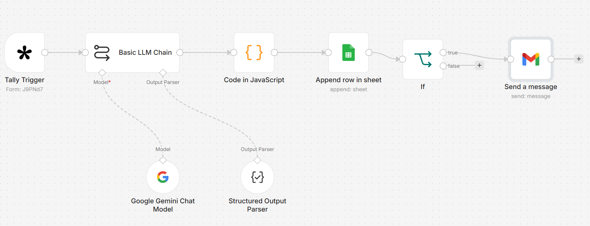

# LeadSift — AI Lead Qualification

An **n8n** workflow that qualifies incoming leads automatically: it reads a form submission, uses **Google Gemini** to extract qualification data, scores the lead, logs it to **Google Sheets**, and emails a follow-up for hot leads.

## How it works

1. **Tally Trigger** — a lead submits the form (Name, Email, Phone, Brief).
2. **Basic LLM Chain (Gemini)** — extracts structured data from the brief: need, pain point, budget, timeline, authority, urgency and purchase intent.
3. **Code** — calculates a lead score out of 100 and classifies the lead.
4. **Google Sheets** — appends the lead with its score and status.
5. **If + Gmail** — when the lead is `HOT`, a follow-up email is sent.

## Scoring

| Signal | Points |
|--------|--------|
| Need identified | 25 |
| Timeline provided | 20 |
| Budget provided | 20 |
| Authority | decision maker 15 · influencer 8 |
| Urgency | high 10 · medium 5 |
| Purchase intent | high 10 · medium 5 |

| Score | Status |
|-------|--------|
| 80 – 100 | `HOT` |
| 50 – 79 | `WARM` |
| 0 – 49 | `COLD` |

## Setup

1. Import `LeadSift.json` into n8n (**Workflows → Import from file**).
2. Install the community node `n8n-nodes-tallyforms`.
3. Create a Tally form with the fields **Name**, **Email**, **Phone** and **Brief**, then select it in the **Tally Trigger** node.
4. In **Basic LLM Chain**, point the `Customer Brief` expression at your form's Brief question.
5. Create a Google Sheet with these columns and select it in **Append row in sheet**:

   `Name · Email · Phone · Brief · Need · Problem · Budget · Timeline · Authority · Urgency · Purchase Intent · Score · Status`

6. Attach your credentials: Tally, Google Gemini, Google Sheets and Gmail.
7. In **Send a message**, set the recipient (e.g. `{{ $json.Email }}` to reply to the lead).
8. Activate the workflow.

## Tech stack

n8n · Google Gemini · Tally · Google Sheets · Gmail
